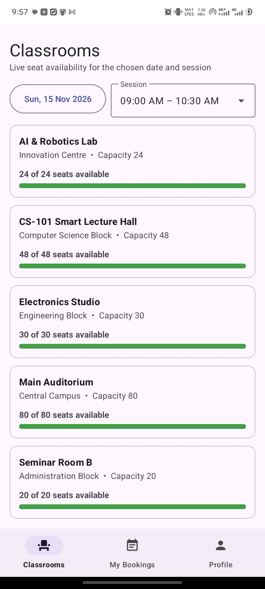
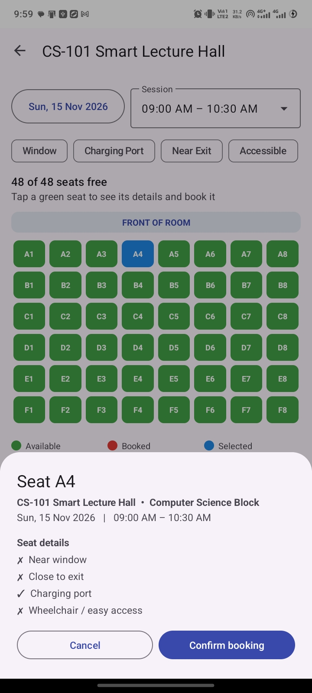
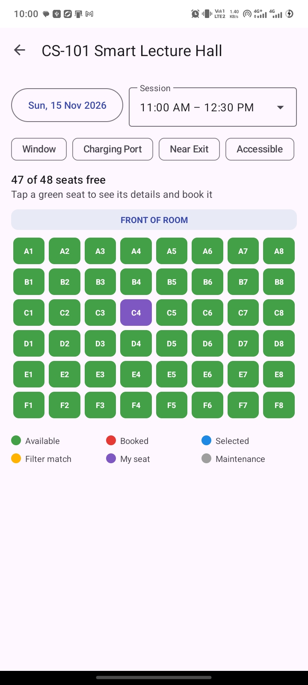
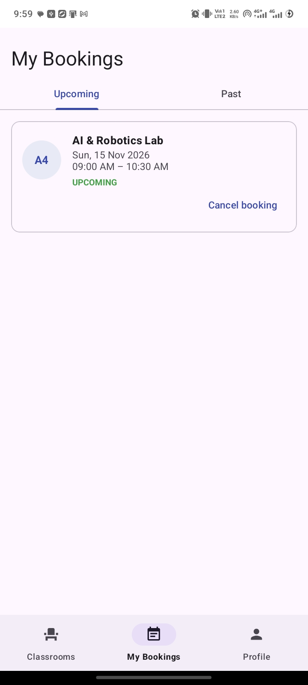

# Smart Classroom Seat Booking (Android, Java, Firebase)

Real-time seat booking for university classrooms. Students browse rooms, pick a date and
session, choose a seat on a colour-coded map and book or cancel it. Admins manage occupancy,
maintenance seats, sessions and conflicting bookings. Seat state syncs live across devices.

**Stack:** Java 17, Android SDK 34 (minSdk 24), XML + Material Design 3, ViewBinding,
Firebase Authentication, Cloud Firestore (snapshot listeners + transactions).

## 1. Setup

1. Open the `SmartClassroom` folder in **Android Studio** (Koala or newer) and let Gradle sync.
2. Create a Firebase project at https://console.firebase.google.com.
3. **Add an Android app** with package name `com.shadowfox.smartclassroom`, download
   `google-services.json` and put it in the `app/` folder (next to `app/build.gradle`).
4. In Firebase console enable **Authentication → Sign-in method → Email/Password**.
5. Create a **Cloud Firestore** database, then open **Rules**, paste the contents of
   `firestore.rules` and publish.
6. Run the app on an emulator or device (Android 7.0+).

On the first login the app seeds 5 classrooms (with per-seat attributes) and 3 sessions
(`DataSeeder`). No Firestore indexes are required.

### Accounts
- **Student:** register normally.
- **Admin / Staff:** on the register screen choose *Admin / Staff* and enter the staff access
  code `STAFF2026` (defined in `RegisterActivity`, demo only).

### Testing real-time sync
Run the app on two emulators/devices (or one device plus an emulator), log in as two students,
open the same room, date and session, and book a seat on one: it turns red on the other
instantly. Booking the same seat at the same moment fails for one user with a clear message.

## 2. Features

| Requirement | Where |
|---|---|
| Registration / login, Student and Admin roles | `ui/auth`, `AuthRepository` |
| 5+ classrooms with capacity and live free-seat count | `ClassroomListFragment`, `ClassroomAdapter` |
| Date + session selection (availability is per session) | date picker + session dropdown |
| Colour-coded seat map (RecyclerView + GridLayoutManager) | `SeatGridAdapter` |
| Seat attributes: window, exit, charging, accessible | `Seat`, `DataSeeder` |
| Filter chips highlight matching free seats | `SeatSelectionActivity` |
| Book / cancel with confirmation bottom sheet | `SeatSelectionActivity`, `BookingHistoryFragment` |
| Real-time updates across devices | Firestore snapshot listeners in `BookingRepository` |
| Booking history (upcoming / past) | `BookingHistoryFragment` |
| Admin: occupancy, block/unblock seats, add/delete sessions, cancel bookings | `AdminDashboardActivity` |
| Atomic conflict prevention | `BookingRepository.bookSeat` (`runTransaction`) |
| Animations | seat pulse on select, alpha fade for filters, `TransitionManager`, bottom sheet, fragment fade |

### Seat colours
| Colour | Meaning |
|---|---|
| Green | Available |
| Red | Booked by someone |
| Blue | Selected by you |
| Amber | Available and matches the active filters (others dim) |
| Purple | Your own booking in this session |
| Grey | Blocked for maintenance |

## 3. How double booking is prevented

Booking runs in one Firestore transaction that reads and then writes two lock documents:

- `slots/{room}_{date}_{session}_{seat}`: the seat for that session
- `slots/u_{user}_{date}_{session}`: one seat per student per session

If either lock exists, or the seat is blocked, the transaction fails and nothing is written.
Cancelling deletes both locks and marks the booking `CANCELLED` in one transaction.

## 4. Data model (Firestore)

```
users/{uid}                      name, email, role (STUDENT | ADMIN)
classrooms/{roomId}              name, building, totalSeats, rows, cols, blockedSeats
  seats/{seatId}                 label, row, col, nearWindow, nearExit, chargingPort,
                                 accessible, blocked
sessions/{sessionId}             label, start, end ("HH:mm" 24h)
bookings/{bookingId}             userId, userName, roomId, roomName, seatId, seatLabel,
                                 sessionId, sessionLabel, sessionStart, sessionEnd,
                                 date (yyyy-MM-dd), status (ACTIVE | CANCELLED), createdAt
slots/{lockId}                   bookingId, userId   (atomic booking locks)
meta/seeded                      marker so seeding runs once
```

## 5. Project structure

```
app/src/main/java/com/shadowfox/smartclassroom/
├── model/        User, Classroom, Seat, Session, Booking
├── repository/   AuthRepository, BookingRepository, Callback
├── ui/
│   ├── auth/     LoginActivity, RegisterActivity
│   ├── home/     MainActivity, ClassroomListFragment, ClassroomAdapter, ProfileFragment
│   ├── booking/  SeatSelectionActivity, SeatGridAdapter
│   ├── history/  BookingHistoryFragment, BookingHistoryAdapter
│   └── admin/    AdminDashboardActivity
└── util/         DataSeeder, DateUtil
```

## 6. Known limitations (honest notes)

- The staff access code and role assignment are client-side for demo purposes. A production
  app should assign roles with a backend or Firebase custom claims.
- Seeding runs from the client (allowed once by the security rules). Production data should be
  loaded with the Admin SDK.
- The repositories are used directly by the UI (no ViewModel layer) to keep the code compact.
- Session "past" checks use the device clock.

## 7. Screenshots

Tested on a physical Android device (vivo V2575) with Firebase Authentication and Cloud Firestore.

**Classroom list: 5 rooms with capacity and live seat availability for the chosen date and session**



**Seat map and booking confirmation bottom sheet (seat attributes shown before confirming)**



**After booking: the student's own seat is purple and the free-seat count drops (47 of 48)**



**My Bookings: upcoming reservation with a cancel option**


